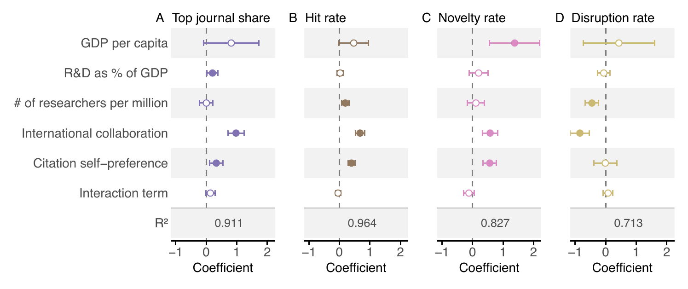
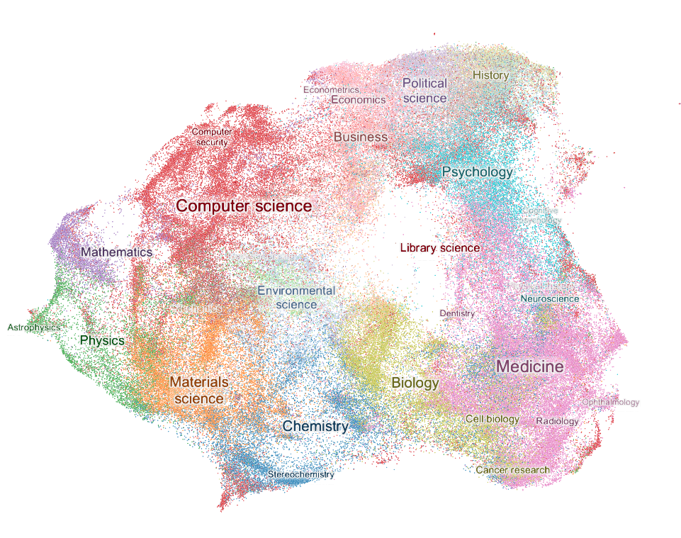
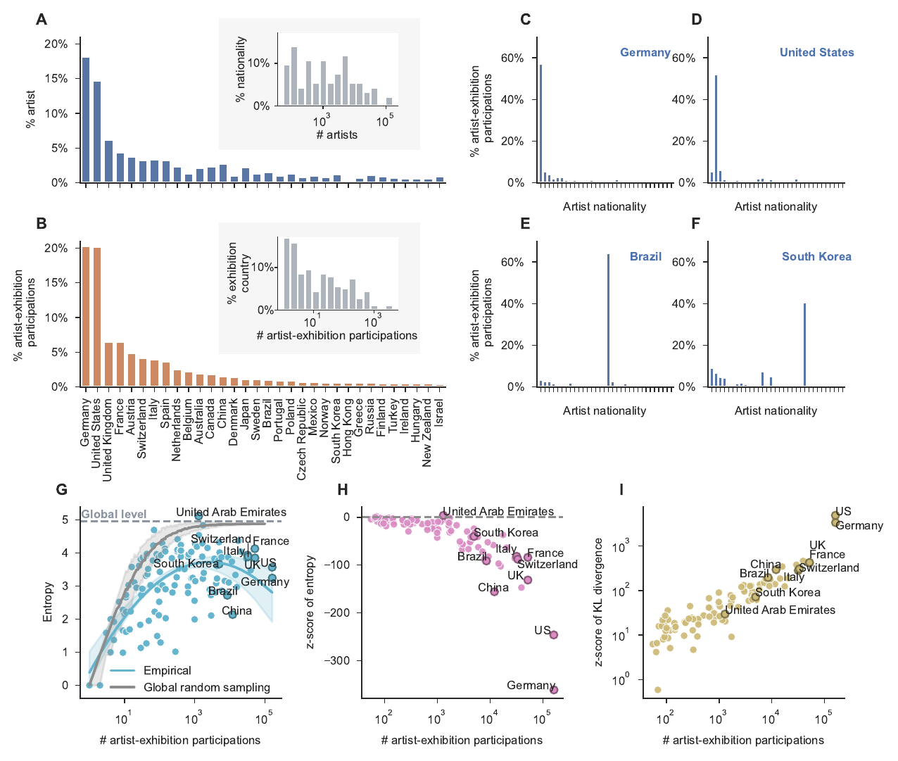
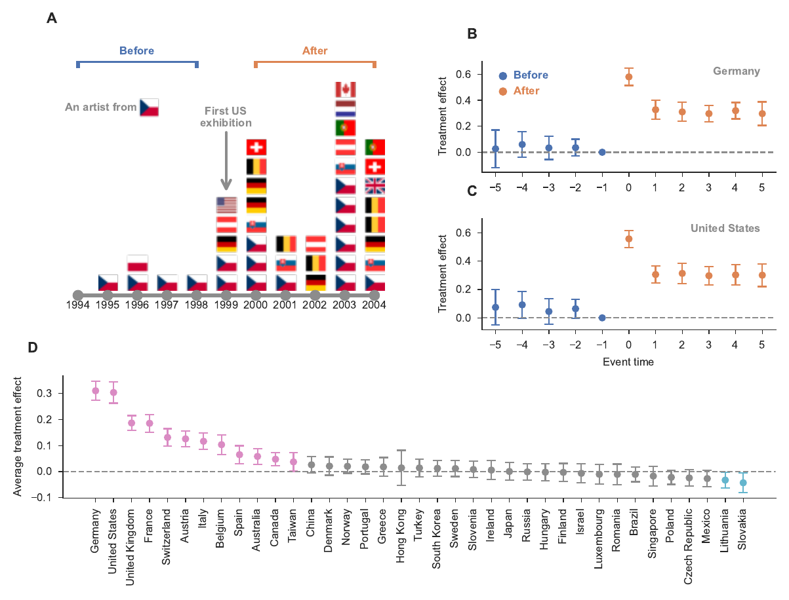
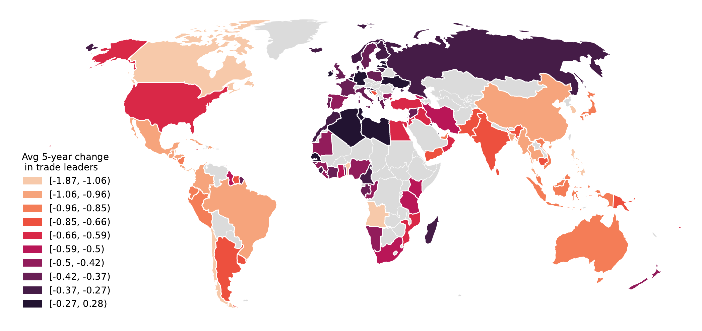
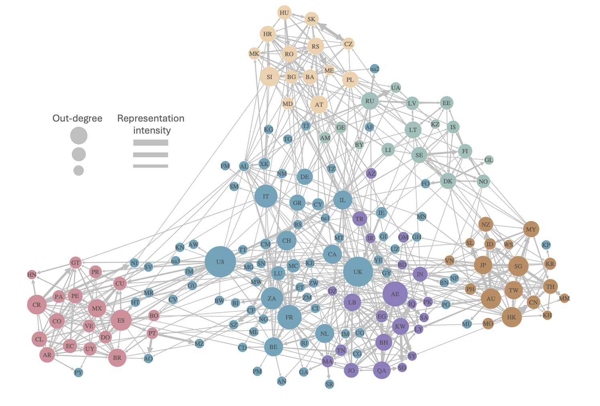
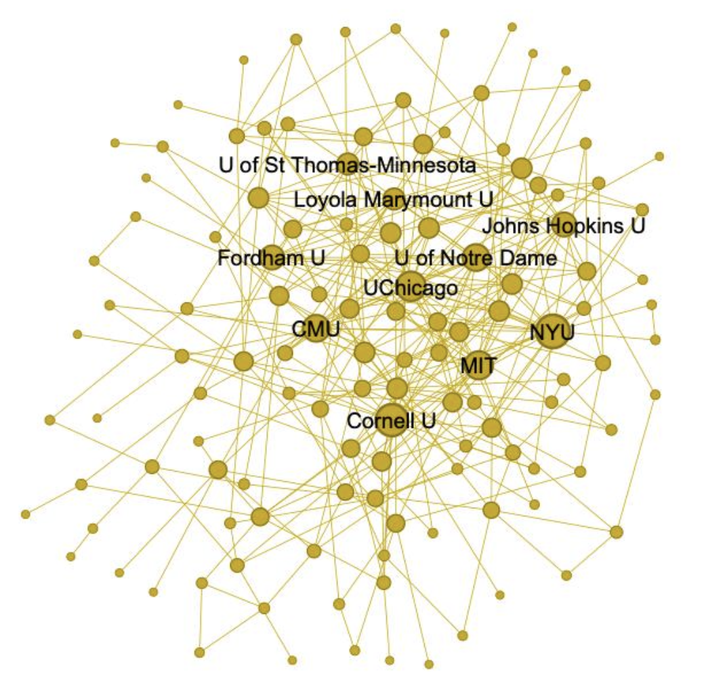

  <h2>Science of Science</h2>
  

    <figure>
      
      <figcaption>Two-way fixed effects panel regression estimates of four national scientific outcomes.</figcaption>
    </figure>
    <figure class="fig-interactive">
      
      <figcaption>The landscape of science: UMAP of SPECTER embeddings for 199,997 SciSciNet papers, coloured by field. <a href="/files/umap_science_landscape.html" target="_blank" rel="noopener">Explore the interactive map &rarr;</a> (opens in a new tab, ~20&nbsp;MB)</figcaption>
    </figure>
  

  <h2>Artworks and Artists</h2>
  

    <figure>
      
      <figcaption>Geographic concentration and nationality diversity in global art exhibitions.</figcaption>
    </figure>
  

  <h2>Causal Inference</h2>
  

    

      <figure>
        
        <figcaption>Geographic capital conversion in contemporary art markets using DiD.</figcaption>
      </figure>
      <figure>
        
        <figcaption>IV validation: average change in predicted trade.</figcaption>
      </figure>
    

  

  <h2>Network Science</h2>
  

    

      <figure>
        
        <figcaption>Network of nationality over-representation in international art exhibitions.</figcaption>
      </figure>
      <figure>
        
        <figcaption>University board interlock network.</figcaption>
      </figure>
    

  

